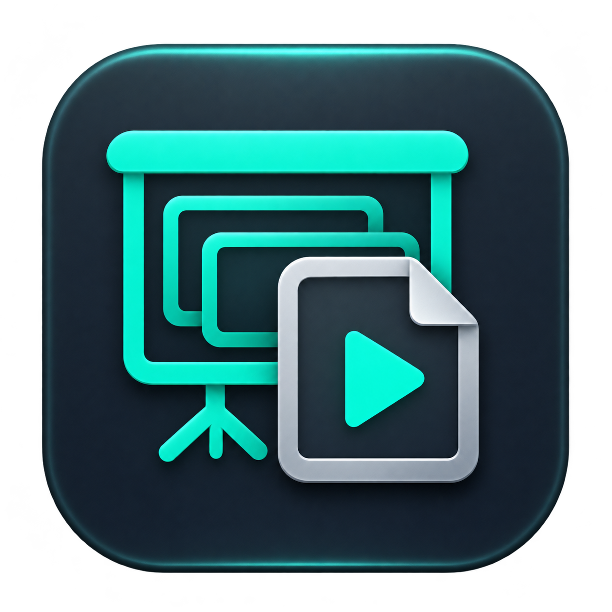
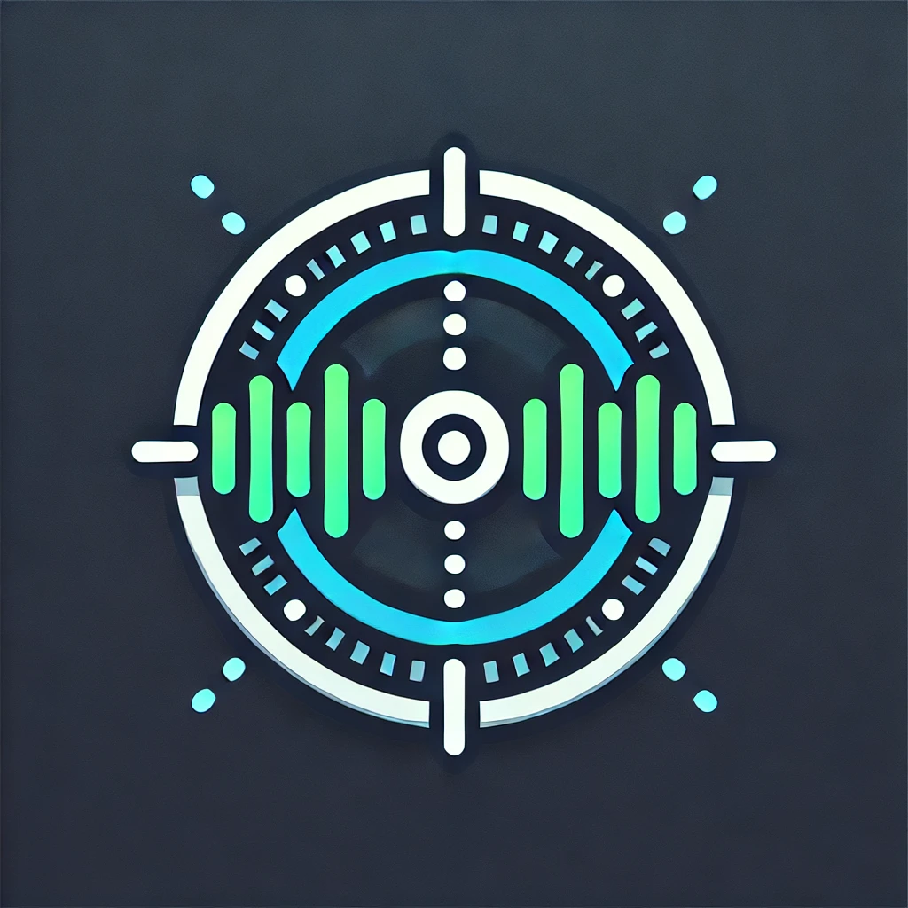
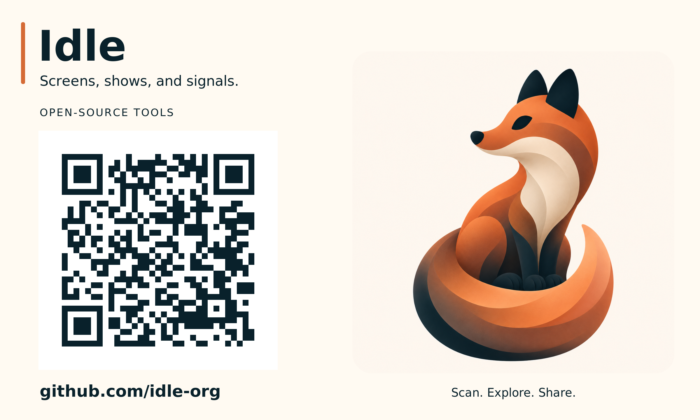

# Idle on GitHub

[**Visit Idle’s public profile →**](https://github.com/idle-org)

This repository contains Idle's public organisation profile, original fox artwork, and default community guidance for its projects.

- `profile/README.md`: the organisation overview.
- `profile/assets/idle.png`: the existing Idle logo, reused from the organisation's supplied branding. This repository does not grant a separate license to the branding.
- `SUPPORT.md`, `CONTRIBUTING.md`, and `ISSUE_TEMPLATE/`: defaults for repositories that do not supply their own equivalents.

Project source belongs in the individual repositories. This repository is maintained independently of project source mirrors.

## The projects

| [Canvas Pilot](https://github.com/idle-org/canvas-pilot) | [Deckstride](https://github.com/idle-org/Deckstride) | [tiny-wb](https://github.com/idle-org/tiny-wb) |
| :---: | :---: | :---: |
|  |  |  |

All three projects are MIT-licensed open-source software, developed with LLM-generated
or LLM-assisted work and human review. They are used in professional settings.
See each project for its documented workflows and limitations.

## Share the organisation

Download the [PNG](profile/assets/idle-share-qr.png) or [SVG](profile/assets/idle-share-qr.svg).
Both encode `https://github.com/idle-org` directly, without a redirect or tracking service.

The [artwork provenance and generation prompt](profile/assets/README.md) document the
fox illustration, existing icons, and QR verification. To rebuild the share card,
install `scripts/requirements-share-card.txt` in a Python virtual environment and run
`python scripts/build-share-card.py`. CairoSVG also requires the system Cairo library.
The QR stays separate from the unchanged generated artwork and retains its quiet zone.
