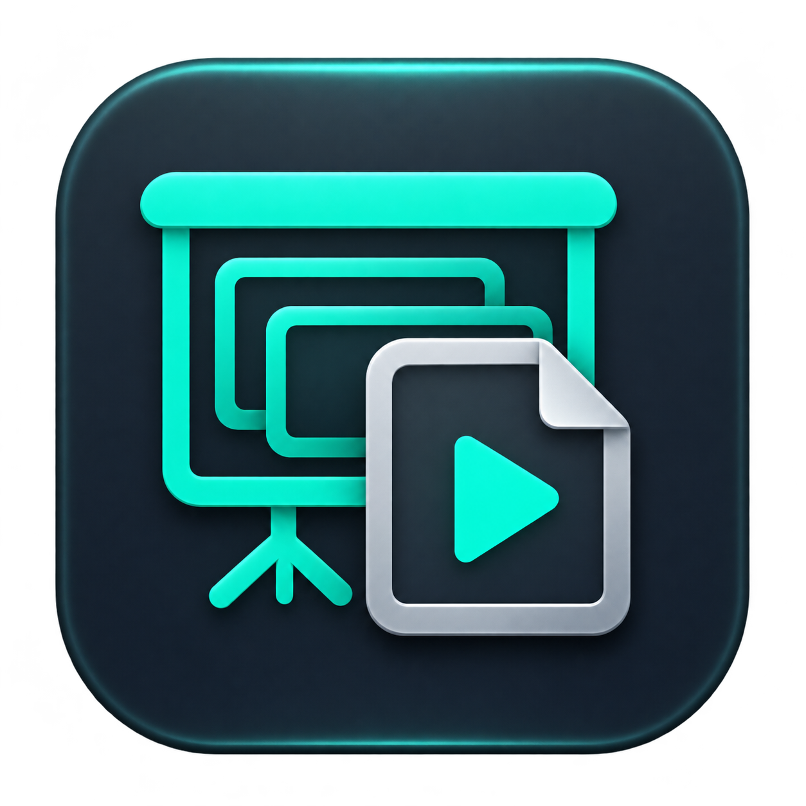
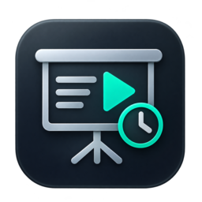
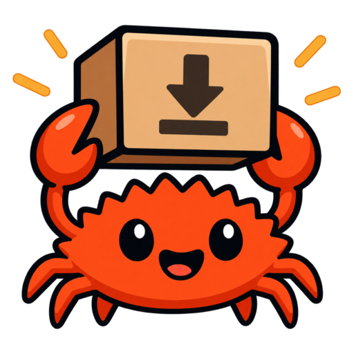

  

<h1 align="center">Practical tools for shows, signals, and software.</h1>

Independent, focused software for live work and the people who build the tools behind it.

### Presentations and live events

Tools for preparing material, running screens, and keeping track of media during
a presentation or show.

| | Project | What it does |
| :---: | :--- | :--- |
|  | **[Canvas Pilot](https://github.com/idle-org/canvas-pilot)** | Compose screen layouts for presentations and live events. Arrange and crop layers, exchange layouts with drawing tools, and send geometry to supported Analog Way switchers. |
|  | **[Deckstride](https://github.com/idle-org/Deckstride)** | Present PDFs and picture folders across multiple displays with private notes, previews, timers, and independent presenter and audience views. |
|  | **[PPTX Reporter](https://github.com/idle-org/pptx-reporter)** | Find the videos in PowerPoint files, calculate their playing times, and create clear PDF, web, text, or Ontime reports. |

### Sound and signal tools

Tools for checking the wireless and radio signals around audio, communications,
and other technical equipment.

| | Project | What it does |
| :---: | :--- | :--- |
|  | **[tiny-wb](https://github.com/idle-org/tiny-wb)** | Use a tinySA scanner to see nearby signals, explore the spectrum, and save measurements for later. |

### Tools for software makers

Tools that help people build and distribute their own applications.

| | Project | What it does |
| :---: | :--- | :--- |
|  | **[rust_realease](https://github.com/idle-org/rust_realease)** | Build a Rust program for several operating systems, package it for download, verify it, and publish a release in one process. |

### Get started

Open a project above for its README, setup instructions, and documentation. Published downloads, when available, live in that project's **Releases** section. Check each project's current requirements and limitations before using it with your equipment or at a live event.

### Open source, openly developed

All five projects are open source under the MIT license. Their development includes
LLM-generated or LLM-assisted work, with human review. They are used in professional
settings; each repository documents its supported workflows and current limitations.

### Say hello

Questions, ideas, or a bug to report? Open an **issue in the relevant GitHub repository**. Include the application version, your operating system, and any equipment involved so the conversation starts with useful context.

These are personal projects, shared for others to use and improve. Thoughtful feedback and contributions are welcome; response times depend on available time.

### Share Idle

Send a friend [github.com/idle-org](https://github.com/idle-org), or share this fox QR card:

[Download the PNG](https://raw.githubusercontent.com/idle-org/.github/main/profile/assets/idle-share-qr.png) · [Download the SVG](https://raw.githubusercontent.com/idle-org/.github/main/profile/assets/idle-share-qr.svg)
