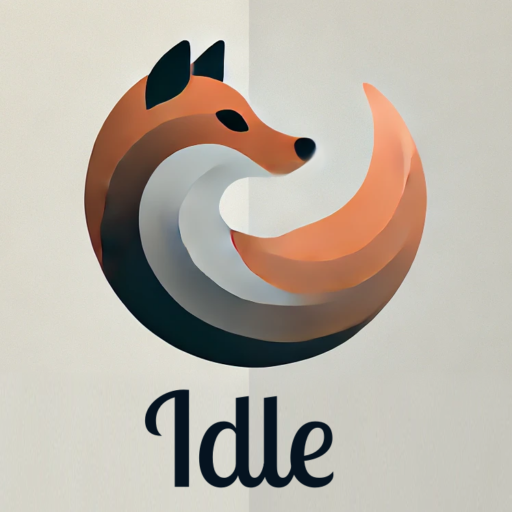
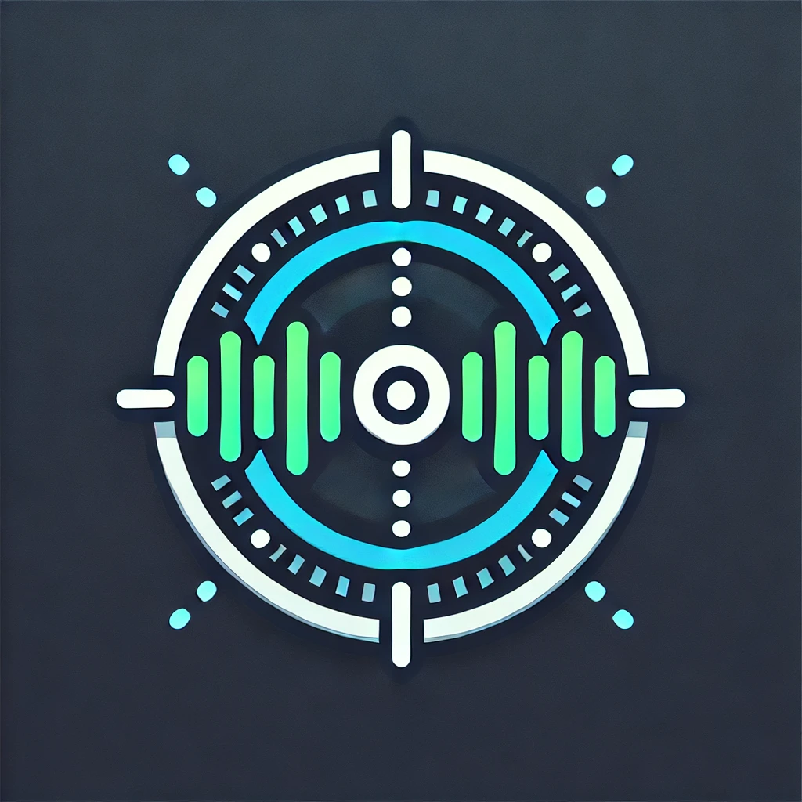
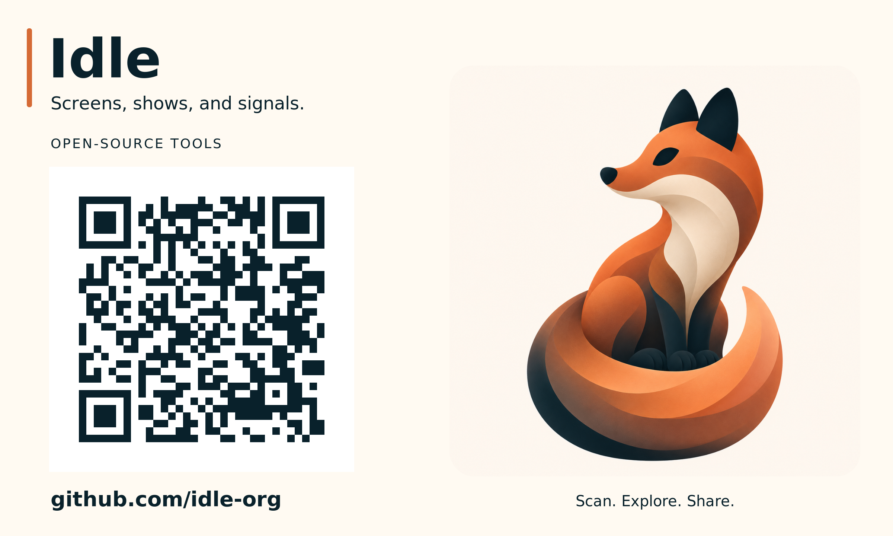

  

<h1 align="center">Practical tools for screens, shows, and signals.</h1>

Independent software for audiovisual work. Small, focused projects for preparing a show, presenting ideas, and exploring the spectrum.

### Find your tool

| | Project | What it does |
| :---: | :--- | :--- |
|  | **[Canvas Pilot](https://github.com/idle-org/canvas-pilot)** | Compose screen layouts for presentations and live events. Arrange and crop layers, exchange layouts with drawing tools, and send geometry to supported Analog Way switchers. |
|  | **[Deckstride](https://github.com/idle-org/Deckstride)** | Present PDFs and picture folders across multiple displays with private notes, previews, timers, and independent presenter and audience views. |
|  | **[tiny-wb](https://github.com/idle-org/tiny-wb)** | Scan with a tinySA, explore the spectrum in your terminal, and save measurements as CSV. |
| 🦀 | **[rust_realease](https://github.com/idle-org/rust_realease)** | Cross-compile Rust command-line tools, build portable packages and checksums, and publish verified releases ready for cargo-binstall. |

### Get started

Open a project above for its README, setup instructions, and documentation. Published downloads, when available, live in that project's **Releases** section. Check each project's current requirements and limitations before using it with your equipment or at a live event.

### Open source, openly developed

All four projects are open source under the MIT license. Their development includes
LLM-generated or LLM-assisted work, with human review. They are used in professional
settings; each repository documents its supported workflows and current limitations.

### Say hello

Questions, ideas, or a bug to report? Open an **issue in the relevant GitHub repository**. Include the application version, your operating system, and any equipment involved so the conversation starts with useful context.

These are personal projects, shared for others to use and improve. Thoughtful feedback and contributions are welcome; response times depend on available time.

### Share Idle

Send a friend [github.com/idle-org](https://github.com/idle-org), or share this fox QR card:

[Download the PNG](https://raw.githubusercontent.com/idle-org/.github/main/profile/assets/idle-share-qr.png) · [Download the SVG](https://raw.githubusercontent.com/idle-org/.github/main/profile/assets/idle-share-qr.svg)
